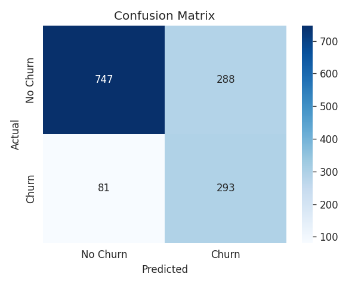
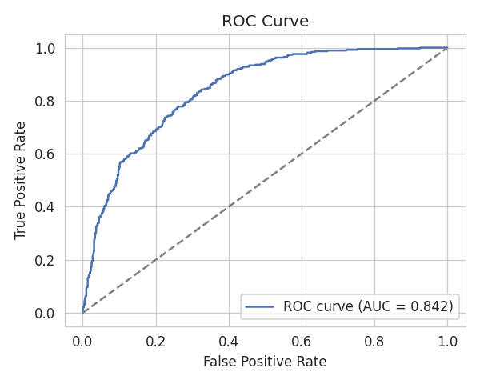
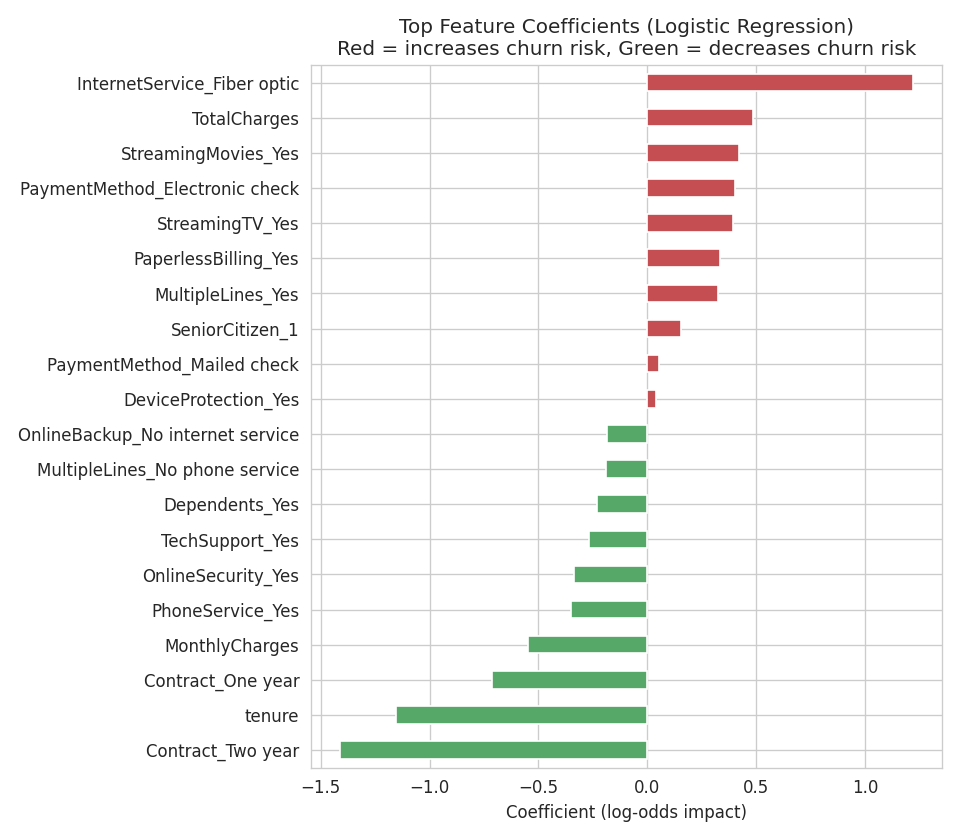

# Customer Churn Prediction — Binary Classification using Logistic Regression

## Project Overview
This project applies Logistic Regression to predict customer churn on the **Telco Customer Churn** dataset (IBM sample dataset, 7,043 customers, 21 features). It demonstrates a complete, end-to-end machine learning workflow: exploratory data analysis, preprocessing, model training, evaluation, interpretation, and reporting.

**Business problem:** Losing a customer (churn) is expensive to replace. A model that flags at-risk customers early lets the business target them with retention offers before they leave.

## Repository Structure
.
├── README.md                                  # This file
├── Report.pdf                                  # Formal technical report
├── notebook/
│   └── Churn_Prediction_Logistic_Regression.ipynb   # Full executed notebook (EDA -> Deployment prep)
├── data/
│   ├── Dataset.csv                             # Raw dataset
│   └── Dataset_clean.csv                       # Cleaned dataset used for modeling
├── charts/
│   ├── 01_churn_distribution.png
│   ├── 02_numerical_histograms.png
│   ├── 03_boxplots_by_churn.png
│   ├── 04_correlation_heatmap.png
│   ├── 05_churn_rate_by_category.png
│   ├── 06_confusion_matrix.png
│   ├── 07_roc_curve.png
│   └── 08_top_coefficients.png
├── outputs/
│   ├── churn_logistic_regression.py            # Standalone script version of the pipeline
│   ├── logistic_regression_model.pkl            # Trained model + scaler + feature schema
│   └── summary.json                             # Machine-readable results summary
└── app/
└── streamlit_app.py                         # Optional deployment app (see below)
## How to Run

### 1. Environment setup
```bash
python3 -m venv venv
source venv/bin/activate         # Windows: venv\Scripts\activate
pip install pandas numpy matplotlib seaborn scikit-learn jupyter streamlit
```

### 2. Run the notebook
```bash
jupyter notebook notebook/Churn_Prediction_Logistic_Regression.ipynb
```
Run all cells top to bottom. Charts and the trained model are written to `charts/` and `outputs/`.

### 3. Or run the standalone script
```bash
python outputs/churn_logistic_regression.py
```
## Dataset
- **Source:** Telco Customer Churn dataset (IBM sample data, distributed on Kaggle: `blastchar/telco-customer-churn`).
- **Rows:** 7,043 customers | **Columns:** 21 (20 features + `Churn` target).
- **Target:** `Churn` — Yes/No, encoded as 1/0.

## Methodology Summary

| Phase | What was done |
|---|---|
| EDA | Checked feature types, class balance (73% No / 27% Yes churn), distributions, correlations, churn rate by category |
| Preprocessing | Imputed 11 missing `TotalCharges` values (new customers) with 0, one-hot encoded categoricals, standardized numerical features, stratified 80/20 train-test split |
| Modeling | `sklearn.linear_model.LogisticRegression` with `penalty='l2'`, `C=1.0`, `solver='lbfgs'`, `class_weight='balanced'` |
| Evaluation | Confusion matrix, accuracy, precision, recall, F1, full classification report, ROC curve & AUC |
| Interpretation | Ranked model coefficients to identify top churn-increasing and churn-decreasing features |

## Results & Model Evaluation
- **Accuracy:** ~0.74
- **Precision (Churn):** ~0.50
- **Recall (Churn):** ~0.78
- **F1 Score (Churn):** ~0.61
- **ROC-AUC:** ~0.84
### Performance Charts
<p align="center">
  
  
</p>

*Full details, metrics, and discussion are available in `Report.pdf` and the executed notebook.*

## Key Insights
* **Contract type and tenure** are the strongest churn-reducing factors — long-term contracts and long-tenured customers rarely churn.
* **Fiber optic internet, month-to-month contracts, and electronic check payment** are the strongest churn-increasing factors.
* Add-ons like **online security and tech support** correlate with lower churn — more "invested" customers stay longer.

### Feature Importance (Model Coefficients)
<p align="center">
  
</p>
## Limitations & Future Work
- Logistic Regression is linear and can't capture complex feature interactions — try Random Forest / XGBoost.
- Class imbalance handled via `class_weight='balanced'`; SMOTE is worth comparing.
- No real cost data for false positives vs. false negatives — the classification threshold (currently 0.5) should ideally be tuned to a business cost matrix.

## Deployment & Live Demo
This project includes an interactive web application built with **Streamlit** that loads the trained model artifact (`outputs/logistic_regression_model.pkl`) to generate live churn predictions.

### How to Run the App Locally
1. Ensure your virtual environment is active and dependencies are installed.
2. Navigate to the root directory and run:
   ```bash
   streamlit run app/streamlit_app.py
   ```
3. Open the local URL (usually `http://localhost:8501`) in your browser to test the interactive dashboard.

### How to Use the App
- Adjust the customer sliders and dropdown menus (Tenure, Contract Type, Internet Service, etc.) in the sidebar.
- Click **Predict Churn** to view the live calculation.
- The app outputs the direct risk probability percentage alongside a clear metric flag indicating if the customer is at high risk of leaving.


